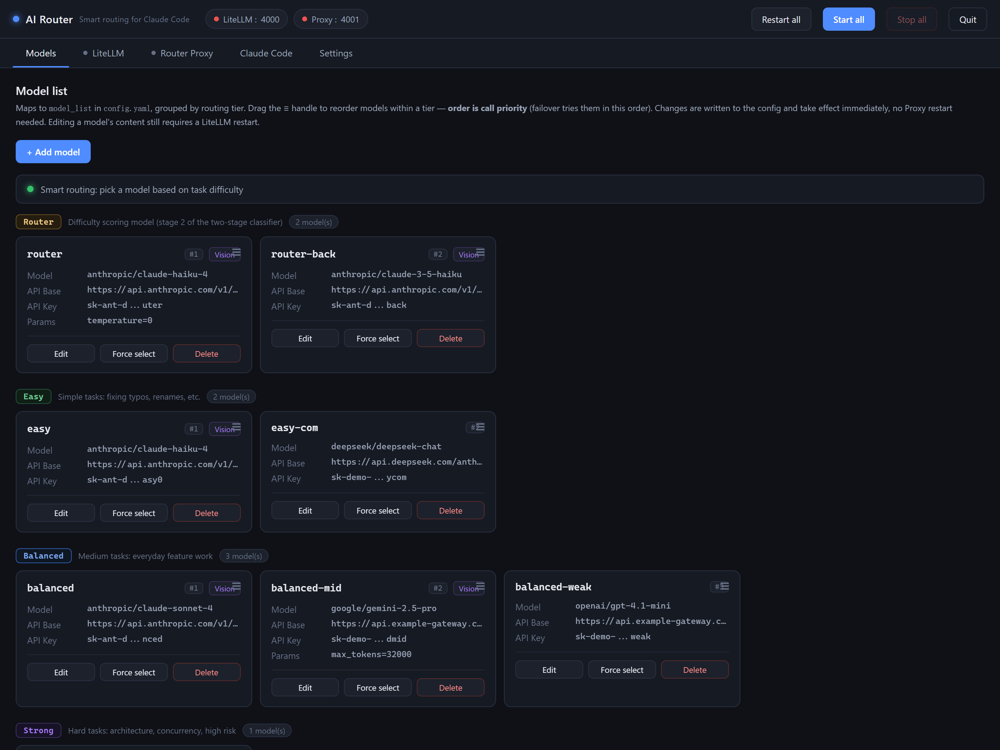
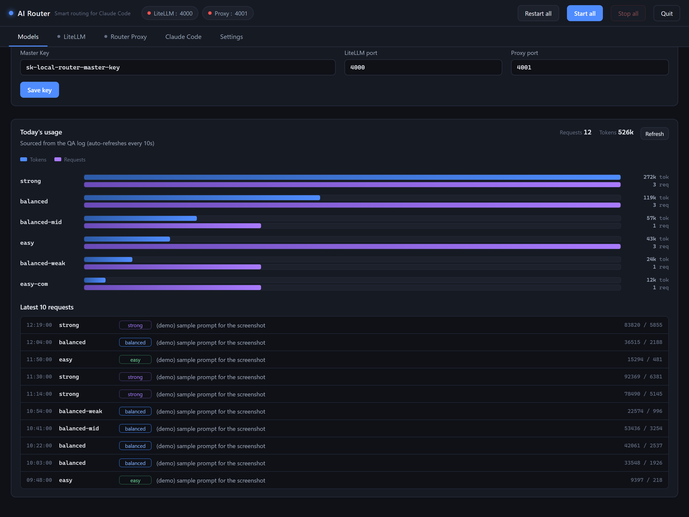
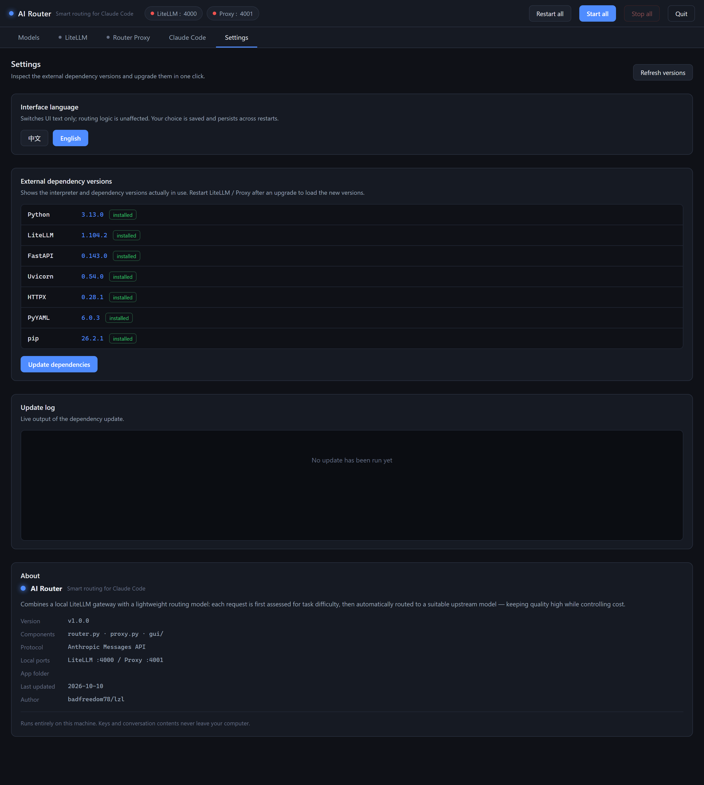

# AI Router · Lightweight smart routing for Claude Code

[中文](README.md) ｜ **English**


Put **Claude Code** on top of multiple LLM APIs and let it **pick the right model tier for each task automatically** — and when one API fails or hits its quota, **automatically switch** to a backup model in the same tier so your work never stops.

- **Lightweight**: a pure-standard-library rule classifier means most requests **never call the router model at all**. No background threads, ~0 idle CPU.
- **High availability**: free API endpoints go down all the time — this app swaps models on error and escalates tiers automatically.
- **Visual console**: a local GUI to add/edit models, watch live logs, review today's usage, and upgrade dependencies in one click.
- **Bilingual UI**: switch between 中文 / English any time from **Settings → Interface language**.
- **Runs locally**: keys and conversation contents never leave your machine.

---

## 1. How it works

```
Claude Code
    │  ANTHROPIC_BASE_URL = http://127.0.0.1:4001
    ▼
Router Proxy  (:4001)        ← the core of this project
    │  1. Score the task difficulty (rules first, LLM only when unsure)
    │  2. Map to the easy / balanced / strong tiers
    │  3. Pick a model by capability (vision/audio) and priority
    │  4. On failure, retry the next candidate in the same/adjacent tier
    ▼
LiteLLM gateway  (:4000)     ← started automatically
    │
    ▼
Your model APIs (Anthropic-compatible endpoints)
```

Tier semantics:

| Tier | Typical tasks | Typical model |
|---|---|---|
| `easy` | Small rewrites, translation, a single function | Small and fast |
| `balanced` | Everyday work: one module, ordinary bug analysis | Mid-range |
| `strong` | Multi-file refactoring, high-risk systems, hard debugging | Strongest |

> The router prompt (`router_prompt.md`) is written in **English** for the broadest
> model compatibility. Edit that file to trim the prompt and save tokens — no code change needed.

---

## 2. Quick start (3 steps)

### Step 1 — Install Python

Install **Python 3.10 or newer**: <https://www.python.org/downloads/>
Make sure to tick **“Add Python to PATH”** during installation.

### Step 2 — Double-click `第一次运行.bat` (“First run”)

It will automatically:

1. Locate a usable Python;
2. Create an isolated virtual environment at `gui\.venv` (your system Python stays clean);
3. Download and install `litellm`, `fastapi` and friends (**the first run is slow — please be patient**);
4. Generate `config.yaml` from `config.example.yaml`;
5. Open the visual console.

> If installation fails, the script prints the command to retry using a mainland-China PyPI mirror.

### Step 3 — Add your own API

Open **`config.yaml`** in a text editor and replace the `api_base` and `api_key` of each
model with **your own real values**, then save. (See the next section.)

Then in the console click **LiteLLM → Start** and **Router Proxy → Start** to connect Claude Code.

> For day-to-day use, double-click **`启动 AI Router.vbs`** — it starts with no console window at all.

---

## 3. Configuring `config.yaml`

The config is copied from the `config.example.yaml` template and contains **placeholders only**.
Each model is one `model_list` entry:

```yaml
- model_name: balanced                       # tier name; the app detects it by prefix - do not rename
  litellm_params:
    model: anthropic/your-balanced-model     # real upstream model, format: provider/model
    api_base: https://your-api-endpoint.example.com/anthropic/v1/messages   # <- your endpoint
    api_key: sk-your-key-here                # <- your key
  model_info:
    supports_vision: true                    # can it read images?
    supports_audio_input: false              # can it take audio input?
```

**Important conventions**

- **`model_name` determines the tier** via its prefix:
  `router` / `router-back` / `easy` / `balanced` / `strong`.
  You may add extra candidates in the same tier (`easy-com`, `balanced-mid`, …),
  but **never change the prefix**.
- **`api_base` must end with `/v1/messages`** (an Anthropic-Messages-compatible endpoint).
  Paths differ per provider — check your provider's docs. For example:
  - Aggregator: `https://your-host/<provider-prefix>/anthropic/v1/messages`
  - MiniMax official: `https://api.minimax.chat/anthropic/v1/messages`
- **Keep this file pure ASCII.** Do not write non-ASCII comments —
  LiteLLM crashes when parsing a YAML file containing non-ASCII text on a
  Windows machine whose default encoding is GBK.
- **`config.yaml` is ignored by `.gitignore`.** Put your real keys only there,
  never in `config.example.yaml`.
- To use a stronger model for a tier, just change `model`. To change priority
  within a tier, reorder the entries in `model_list` (**earlier = higher priority**).

`router` / `router-back` are the **routing models** (they score task difficulty);
`easy` / `balanced` / `strong` are the ones that actually answer.
If your endpoint has no tool-calling or reasoning models, pick any cheap, fast
model for `router`.

---

## 4. Connecting Claude Code

Set these environment variables in the terminal that launches Claude Code
(effective for the current session only):

```bat
set ANTHROPIC_BASE_URL=http://127.0.0.1:4001
set ANTHROPIC_AUTH_TOKEN=sk-anything
set ANTHROPIC_MODEL=router
```

Windows PowerShell:

```powershell
$env:ANTHROPIC_BASE_URL = "http://127.0.0.1:4001"
$env:ANTHROPIC_AUTH_TOKEN = "sk-anything"
$env:ANTHROPIC_MODEL = "router"
```

`ANTHROPIC_AUTH_TOKEN` can be anything — the proxy does not validate it. `sk-anything` is fine.

**To make it permanent**, write the following into `%USERPROFILE%\.claude\settings.json`
(user level) or `.claude\settings.json` inside a project:

```json
{
  "env": {
    "ANTHROPIC_BASE_URL": "http://127.0.0.1:4001",
    "ANTHROPIC_AUTH_TOKEN": "sk-anything",
    "ANTHROPIC_MODEL": "router"
  }
}
```

The console's **Claude Code** tab shows the very same content with a copy button.

---

## 5. The visual console

The console is a local web UI (default port **5178**) with six tabs:

- **Models** — add / edit / delete models. A **routing-mode banner** sits at the top,
  and every card has a one-click **“Force select”** (pin all traffic to this model,
  temporarily disabling smart routing) / **“Unforce”** (restore smart routing).
  Changes apply immediately, no restart. At the bottom is the **usage panel**:
  the latest 10 requests (model / tier / tokens) plus per-model bar charts of
  today's token usage and request counts.
- **LiteLLM / Router Proxy** — start and stop the two services, watch live logs and health.
- **Claude Code** — environment variables and the `settings.json` snippet.
- **Settings** — **interface language (中文 / English)**, external dependency versions,
  **one-click dependency update** (with live log), and an **About** box.

### Screenshots

**Models tab** — cards grouped by tier (Router / Easy / Balanced / Strong), each with one-click “Force select”:



**Usage panel** (bottom of the same tab) — bar charts of today's token usage and request count per model, plus the latest 10 requests:



**Settings tab** — interface language, external dependency versions with one-click update, and the About box:



Your language choice is saved to `gui_settings.json` and persists across restarts.
Switching language **only affects UI text** — routing logic and backend logs are untouched.

---

## 6. Directory layout

```
ai-router-release/
├─ 第一次运行.bat          ← First run: install & launch (double-click this)
├─ 启动 AI Router.vbs      ← Everyday launcher (no console window)
├─ config.example.yaml     ← Template with placeholders (safe to commit)
├─ config.yaml             ← Your real config (created on first run, gitignored)
├─ README.md / README.en.md
├─ LICENSE                 ← MIT license
├─ .gitignore
│
├─ router.py               ← Routing logic: scoring, tier and model selection
├─ classifier.py           ← Pure-stdlib rule classifier (skips most router-LLM calls)
├─ failover.py             ← Model health cooldown and failover
├─ model_priority.py       ← Derives intra-tier priority from config.yaml order
├─ proxy.py                ← Router Proxy service (:4001)
├─ router_prompt.md        ← Router model prompt (English; trim to save tokens)
│
├─ gui/
│   ├─ main.py              ← Console entry point (desktop window / browser)
│   ├─ app.py               ← Local HTTP API for the console
│   ├─ backend.py           ← Process orchestration, config I/O, usage aggregation, language
│   ├─ requirements.txt     ← Dependency list
│   └─ frontend/index.html  ← Console UI (with zh/en dictionaries)
│
├─ tests/
│   └─ test_offline.py     ← Offline self-test (45 checks, no network, no LiteLLM)
└─ docs/                   ← Screenshots used by the READMEs
```

> The repo also ships `.github/workflows/tests.yml`: every push / PR runs the
> offline self-test above on Ubuntu and Windows × Python 3.10 / 3.12.

**Created automatically at runtime** (no manual setup needed):

| Path | Purpose |
|---|---|
| `logs/qa_log.jsonl` | QA log (data source for the usage panel) |
| `router_override.json` | State file for “Force select” |
| `gui_settings.json` | Interface language setting |
| `gui/gui_error.log` | Console crash log (fallback when running without a console) |
| `gui/.venv/` | Virtual environment created on first run |

---

## 7. FAQ

**Q: The UI is in English — how do I switch back to Chinese?**
Settings → Interface language → 中文. Both languages are fully equivalent.

**Q: Router Proxy won't start, saying it can't find a Python interpreter?**
First check that step 2 finished installing dependencies (the `gui\.venv` folder must
exist and be non-empty). If it still fails, run `第一次运行.bat` again to reinstall.

**Q: A model errors out or hits its quota — what do I do?**
Nothing. The app automatically retries with another model **in the same tier**;
if the whole tier is unavailable it tries adjacent tiers. The `x-router-model`
response header shows which model actually served the request, and the console's
usage panel shows it too.

**Q: How do I disable smart routing and pin one model?**
Click **“Force select”** on that model's card in the Models tab. It applies immediately.

**Q: How do I temporarily disable “rules first” (so every request calls the router model)?**
Set the environment variable `ROUTER_RULE_FIRST=0` and restart Router Proxy.
Set it back to `1` (the default) to restore.

**Q: Do I need to restart after editing `config.yaml`?**
Yes. LiteLLM reads `config.yaml`; after editing, click **Stop → Start** on LiteLLM in the console.

**Q: The console window flashes and disappears / won't open?**
Check `gui\gui_error.log`, or run `gui\.venv\Scripts\python.exe gui\main.py`
in a terminal to see the error directly.

---

## 8. Ports

| Port | Service | Notes |
|---|---|---|
| `5178` | Visual console | local access only |
| `4000` | LiteLLM gateway | started automatically by the console |
| `4001` | Router Proxy | **this is what Claude Code points at** |

---

## 9. About

- Author: **badfreedom78/lzl**
- Last updated: 2026-10-10
- All keys and conversation contents stay on this machine; nothing is uploaded to any third party.
